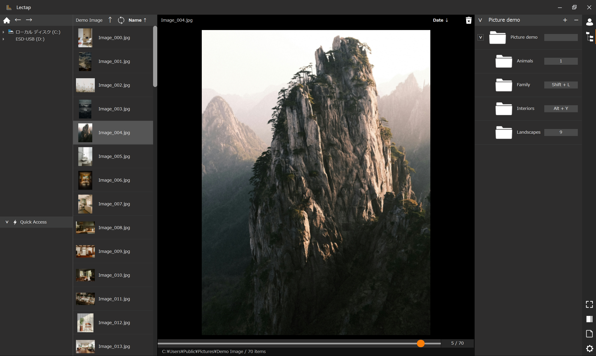
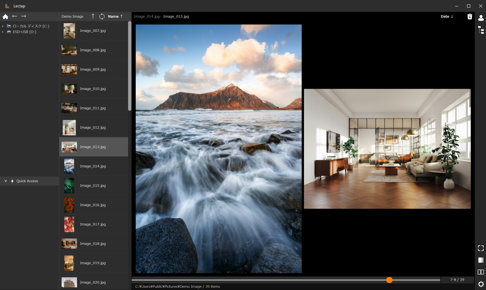
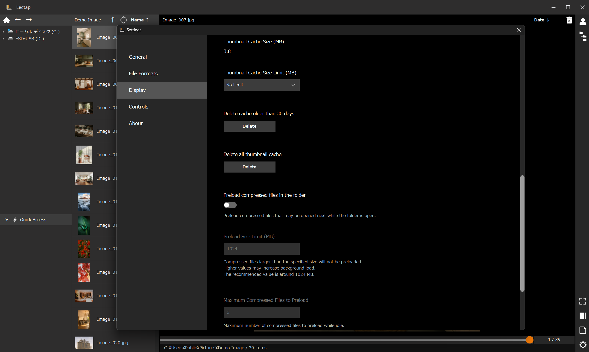
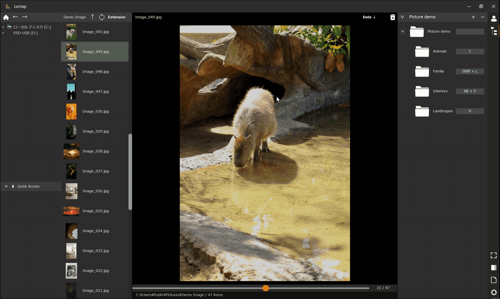

# Lectap

**Image Viewer & File Sorter for Windows**

[日本語版 README](README_JA.md)

Lectap is a Windows desktop app for viewing images and archive contents while quickly sorting files into preset folders.

Keyboard shortcuts and mouse operations let you move from viewing to organizing in a single screen.

## What’s New in v1.0.1

・Adjusted taskbar behavior when the window is maximized.

・Added support for registering multiple destination folders at once.

## Screenshots and Demo



View the image list, central preview, and destination folders in one screen.



View left and right pages side by side in two-page mode.



Manage thumbnail cache and archive preloading in Display settings.



Choose a registered destination folder to move the current image and continue with the next one.

## Main Features

- Browse images in folders and archives
- Preview the first page of each archive in folders without loose images
- Move files to registered destination folders
- Assign keyboard shortcuts to individual folders
- Switch the right column between profile and folder-tree views
- Browse ZIP, EPUB, and RAR archives without manually extracting them first
- Single-page and two-page viewing
- Customize keyboard, wheel, middle-button, and mouse-gesture actions
- Resume from the previous viewing position
- Undo file moves, deletions, and renames
- Export and import settings

## Supported Formats

### Images

`JPG` / `JPEG` / `PNG` / `BMP` / `WebP` / `GIF`

GIF files are displayed as their first frame only. Animation playback may be considered alongside a future video-playback feature.

### Archives

`ZIP` / `EPUB` / `RAR`

RAR browsing requires a separate installation of [7-Zip](https://www.7-zip.org/). 7-Zip is not bundled with Lectap.

Lectap currently detects the 64-bit 7-Zip executable at its default installation path: `C:\Program Files\7-Zip\7z.exe`. It does not detect 7-Zip installed elsewhere, 32-bit 7-Zip, or `7z.exe` available only through `PATH`.

## Download and Run

Official distribution is available only through GitHub Releases.

1. Download the latest `Lectap-1.0.0-win-x64.zip` from [GitHub Releases](https://github.com/chihaya-dev/Lectap/releases).
2. Extract the ZIP file to a folder of your choice.
3. Run `Lectap.exe` in the extracted folder.

Lectap does not use an installer. To remove the app, delete the extracted folder. Settings and cache data are stored separately; remove the folder described in “Stored Data and Privacy” as well when no longer needed.

## First-Run Warnings and Download Verification

The first public release is not code-signed, so Microsoft Defender SmartScreen or other security software may display a warning or confirmation when downloading, starting, or performing file operations.

Lectap does not automatically send your images, settings, or browsing history outside your computer.

Before running the app, verify that the ZIP file came from the official GitHub Releases page and that its SHA-256 value matches the corresponding entry in the `SHA256SUMS.txt` file attached to the same release. Your organization's security policy or Windows Smart App Control may still prevent execution.

Use the following PowerShell command to verify the ZIP file’s SHA-256 value.

```powershell
Get-FileHash -LiteralPath .\Lectap-1.0.0-win-x64.zip -Algorithm SHA256
```

## System Requirements

- Tested on Windows 11 x64
- 7-Zip is required for RAR browsing

Operation on other Windows environments is not guaranteed.

## Basic Usage

1. Register destination folders in the right column. You can also add a folder by dropping it into the right column.
2. Assign keyboard shortcuts to registered folders as needed.
3. Select an image or archive from the left column.
4. Review its contents, then choose a destination with a keyboard or mouse action.
5. Use Undo to reverse a file move, deletion, or rename.

## Settings Backup

From the Settings window, you can export Lectap settings as a JSON file.

Importing an exported file restores profiles, destination folders, Quick Access entries, keyboard shortcuts, mouse actions, and related settings.

Device-specific data such as window position, window size, browsing history, and thumbnail cache is not included in exported settings.

## Stored Data and Privacy

Lectap stores settings, logs, thumbnail cache, and undo data in the following location.

```text
%LOCALAPPDATA%\Lectap
```

Lectap does not automatically send your images, settings, or browsing history outside your computer.

Stored data can remain after the app is removed. Delete the folder above manually when you no longer need its settings or cache.

## Notes and Limitations

- Back up important files before working with them in Lectap.
- Password-protected archives are not supported.
- Corrupted archives or unsupported compression methods may not open.
- The first access to network drives, USB storage, or sleeping HDDs can take time.
- When you transfer settings to another PC, destination-folder and Quick Access paths remain in the settings even if the corresponding folders do not exist on that PC.

## Updates

Lectap has no automatic update feature. Check [GitHub Releases](https://github.com/chihaya-dev/Lectap/releases) for the latest version and read each release note for changes.

## Contact

Report bugs or suggest features through [GitHub Issues](https://github.com/chihaya-dev/Lectap/issues).

When reporting an issue, include the Lectap version, Windows version, reproduction steps, displayed message, and affected file format where possible. Do not post local paths, Windows user names, or other personal information.

For security concerns or suspected vulnerabilities, do not open a public issue. See [Security reporting](SECURITY.md).

## Author

Chihaya Abutsuka

[GitHub: chihaya-dev](https://github.com/chihaya-dev)

Copyright © 2026 Chihaya Abutsuka

## Terms of Use

Lectap’s Terms of Use are available in Japanese at [TERMS_OF_USE.md](TERMS_OF_USE.md). The Japanese version is authoritative.

The download includes `README_EN.txt` and `README_JA.txt`. On GitHub, the English and Japanese guides are `README.md` and `README_JA.md`, respectively.

Third-party license notices are available in [THIRD_PARTY_NOTICES.md](THIRD_PARTY_NOTICES.md).

## Support

Lectap is free to use.

If Lectap is useful to you, please consider supporting its development with a coffee through [Buy Me a Coffee](https://buymeacoffee.com/chihayadev).

Payment and personal-information handling for support are governed by the terms and privacy policies of Buy Me a Coffee and Stripe. The developer does not receive card information.
