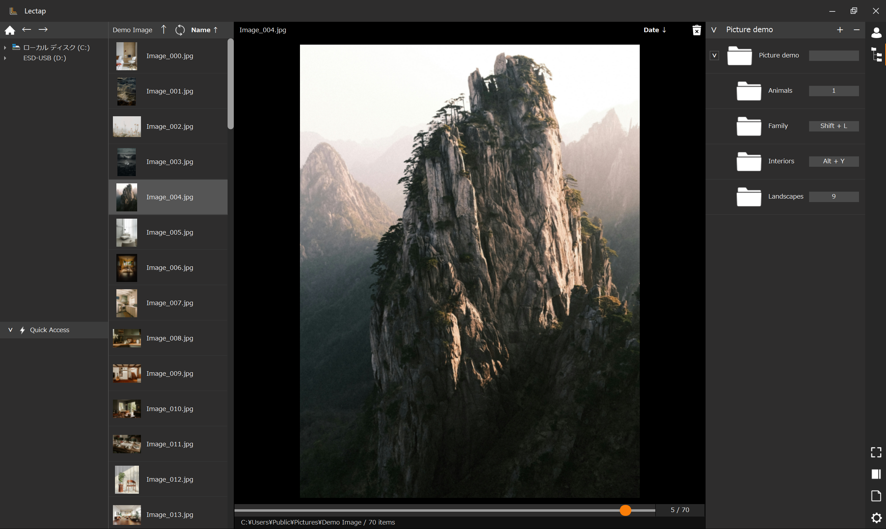
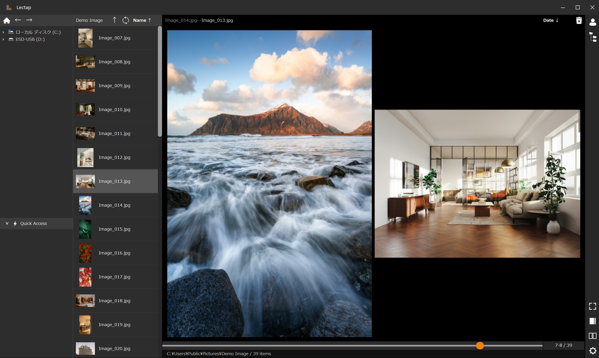
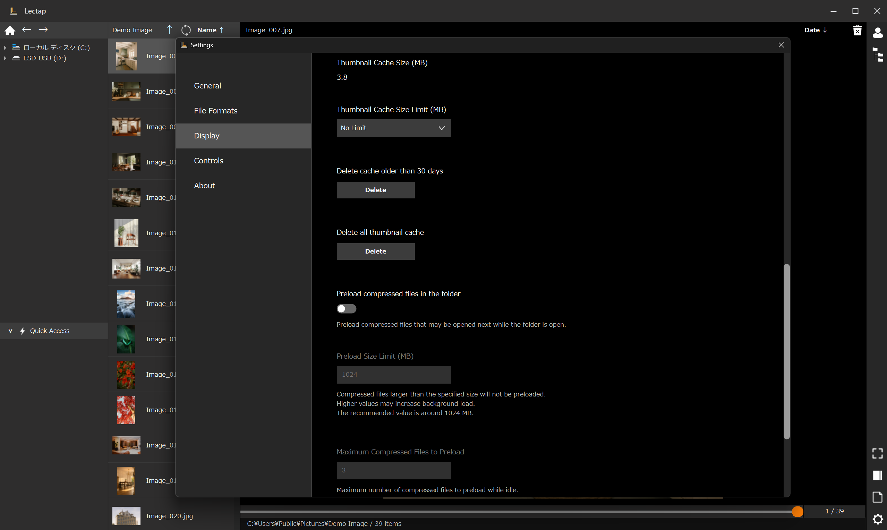
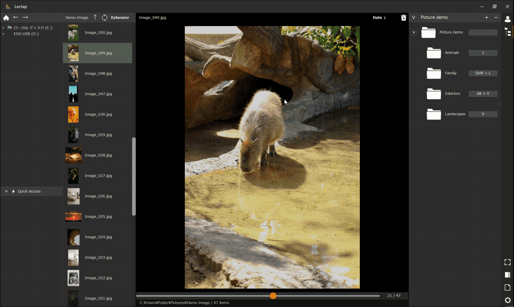

# Lectap

**Image Viewer & File Sorter for Windows**

[English README](README.md)

Lectapは、画像やアーカイブの閲覧と、指定したフォルダへのファイルの素早い振り分けをひとつでこなせるWindows向けデスクトップアプリです。

キーボードショートカットやマウス操作を使い、閲覧から整理までを一つの画面で行えます。

## スクリーンショットと操作例



画像一覧、中央プレビュー、移動先フォルダを一画面で確認できます。



見開き表示では、左右のページを並べて確認できます。



表示設定では、サムネイルキャッシュやアーカイブの先読みを管理できます。



登録した移動先フォルダを選ぶと、表示中の画像を振り分け、次の画像を続けて確認できます。

## 主な機能

- 画像フォルダとアーカイブ内の画像を閲覧
- 画像が直接入っていないフォルダで、各アーカイブの先頭画像を順に閲覧
- 登録した移動先フォルダへのファイル移動
- フォルダごとのショートカットキー設定
- プロファイル表示とフォルダツリー表示を切り替えられる右カラム
- ZIP、EPUB、RARを手動で展開せずに閲覧
- 単ページ表示と見開き表示
- キーボード、ホイール、中央ボタン、マウスジェスチャーのカスタマイズ
- 前回の閲覧位置からの再開
- 移動・削除・名前変更の取り消し
- 設定のエクスポートとインポート

## 対応形式

### 画像

`JPG` / `JPEG` / `PNG` / `BMP` / `WebP` / `GIF`

GIFは先頭フレームのみを表示します。アニメーション再生は、将来の動画再生機能とあわせて対応を検討します。

### アーカイブ

`ZIP` / `EPUB` / `RAR`

RARの閲覧には、別途 [7-Zip](https://www.7-zip.org/) のインストールが必要です。7-ZipはLectapに同梱されません。

Lectapは現在、64bit版7-Zipの既定のインストール先である `C:\Program Files\7-Zip\7z.exe` を検出します。別の場所へインストールした7-Zip、32bit版、またはPATH上の `7z.exe` は検出対象になりません。

## ダウンロードと起動

公式配布はGitHub Releasesのみです。

1. [GitHub Releases](https://github.com/chihaya-dev/Lectap/releases) から最新の `Lectap-1.0.0-win-x64.zip` をダウンロードします。
2. ZIPファイルを任意の場所へ展開します。
3. 展開したフォルダ内の `Lectap.exe` を実行します。

インストーラーは使用しません。Lectapを削除する場合は、展開したフォルダを削除してください。設定やキャッシュなどの保存データは別途残るため、不要であれば「保存データとプライバシー」に記載したフォルダも削除してください。

## 初回起動時の警告とダウンロードの確認

初回公開版はコード署名を行っていないため、Microsoft Defender SmartScreenや一部のセキュリティソフトが、ダウンロード時、起動時、またはファイル操作時に警告や確認を表示する場合があります。

Lectapは、利用者の画像、設定、閲覧履歴を自動的に外部へ送信しません。

実行する前に、公式GitHub Releasesから取得したファイルであることと、同じリリースに添付する `SHA256SUMS.txt` の値が一致することを確認してください。組織のセキュリティポリシーやWindowsのSmart App Controlにより、実行が許可されない場合があります。

PowerShellでは、次のコマンドでZIPファイルのSHA-256を確認できます。

```powershell
Get-FileHash -LiteralPath .\Lectap-1.0.0-win-x64.zip -Algorithm SHA256
```

## 動作環境

- Windows 11 x64で動作確認済み
- RARを閲覧する場合は7-Zipが必要

ほかのWindows環境での動作は保証していません。

## 基本的な使い方

1. 右カラムに移動先フォルダを登録します。フォルダを右カラムへドロップして追加することもできます。
2. 必要に応じて、登録したフォルダへショートカットキーを設定します。
3. 左カラムから画像またはアーカイブを選択します。
4. 内容を確認し、キー操作またはマウス操作で移動先を選びます。
5. 移動・削除・名前変更は、取り消し操作で元に戻せます。

## 設定のバックアップ

設定画面から、Lectapの設定をJSONファイルとしてエクスポートできます。

エクスポートした設定ファイルをインポートすると、プロファイル、移動先フォルダ、クイックアクセス、ショートカットキー、マウス操作などを復元できます。

画面位置、ウィンドウサイズ、閲覧履歴、サムネイルキャッシュなどの端末固有データは、設定ファイルのエクスポート対象に含まれません。

## 保存データとプライバシー

Lectapは、設定、ログ、サムネイルキャッシュ、取り消し用データなどを次の場所へ保存します。

```text
%LOCALAPPDATA%\Lectap
```

Lectapは、利用者の画像、設定、閲覧履歴などを自動的に外部へ送信しません。

アプリを削除した後も保存データが残る場合があります。不要になった設定やキャッシュは、必要に応じて上記フォルダを手動で削除してください。

## 注意事項と制限

- 重要なファイルを扱う前に、必ずバックアップを作成してください。
- パスワードで保護されたアーカイブには対応していません。
- 破損したアーカイブや未対応の圧縮方式は開けない場合があります。
- ネットワークドライブ、USBストレージ、休止状態のHDDなどでは、最初のアクセスに時間がかかる場合があります。
- 設定を別のPCへ移行した場合、登録先フォルダやクイックアクセスのパスが存在しなくても設定自体は保持されます。

## 更新

自動更新機能はありません。最新版は [GitHub Releases](https://github.com/chihaya-dev/Lectap/releases) から確認してください。各バージョンの変更内容は、GitHub Releasesのリリースノートを参照してください。

## 問い合わせ

不具合報告や機能に関する提案は、[GitHub Issues](https://github.com/chihaya-dev/Lectap/issues) へお願いします。

報告時には、可能な範囲でLectapのバージョン、Windowsのバージョン、再現手順、表示されたメッセージ、対象ファイルの形式を添えてください。ローカルパス、Windowsユーザー名、個人情報を含む内容は投稿しないでください。

セキュリティ上の問題や脆弱性の可能性がある内容は公開Issueに投稿せず、[非公開の報告方法](SECURITY.md)をご確認ください。

## 作者

Chihaya Abutsuka

[GitHub: chihaya-dev](https://github.com/chihaya-dev)

Copyright © 2026 Chihaya Abutsuka

## 利用条件

Lectapの利用条件は [TERMS_OF_USE.md](TERMS_OF_USE.md) を参照してください。

利用条件の日本語版を正本とします。

配布ZIPには `README_EN.txt` と `README_JA.txt` を同梱します。

第三者コンポーネントのライセンス表記は、[THIRD_PARTY_NOTICES.md](THIRD_PARTY_NOTICES.md) に掲載します。

## 支援

Lectapは無料で利用できます。

Lectapがお役に立てたら、[Buy Me a Coffee](https://buymeacoffee.com/chihayadev) からコーヒー1杯分の任意のご支援をご検討ください。

支援時の決済および個人情報の取り扱いは、Buy Me a CoffeeおよびStripeの規約とプライバシーポリシーに従います。開発者はカード情報を取得しません。
